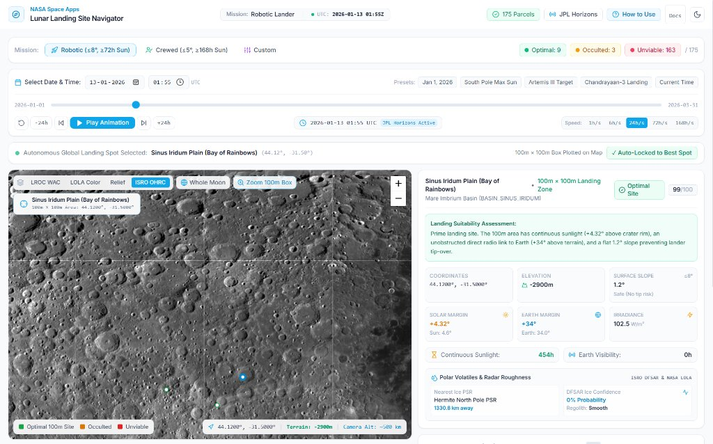
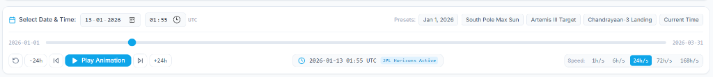
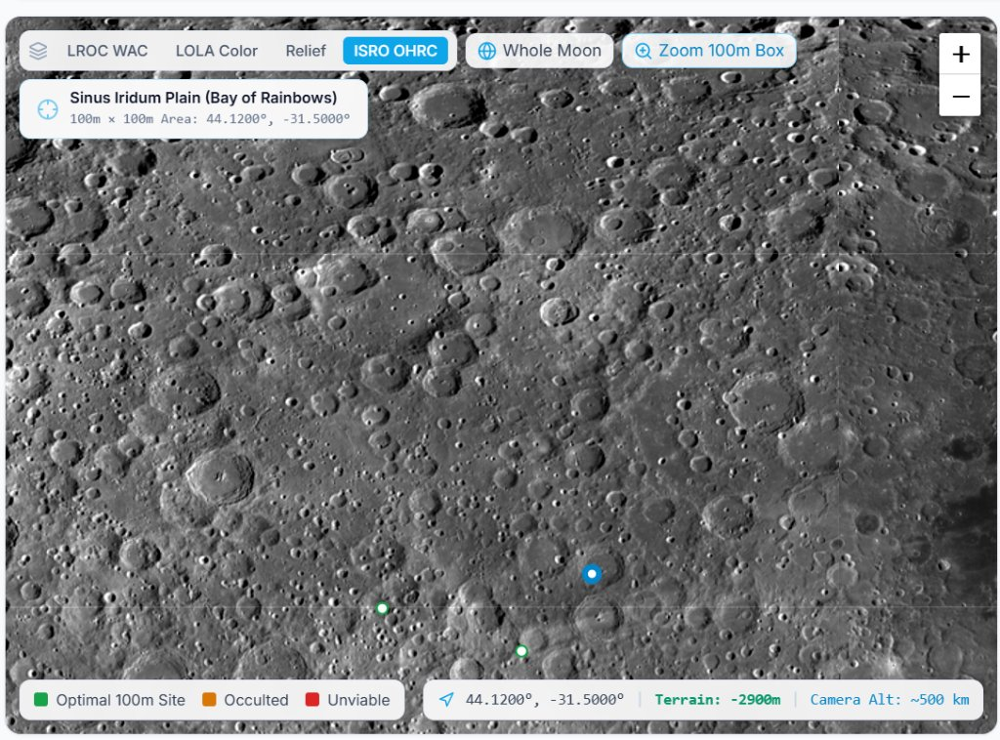
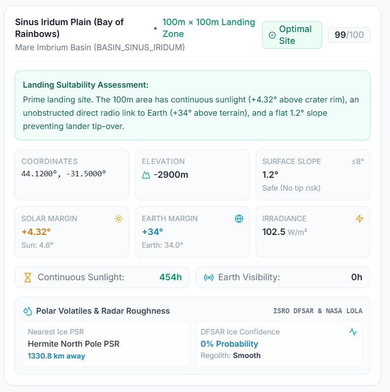
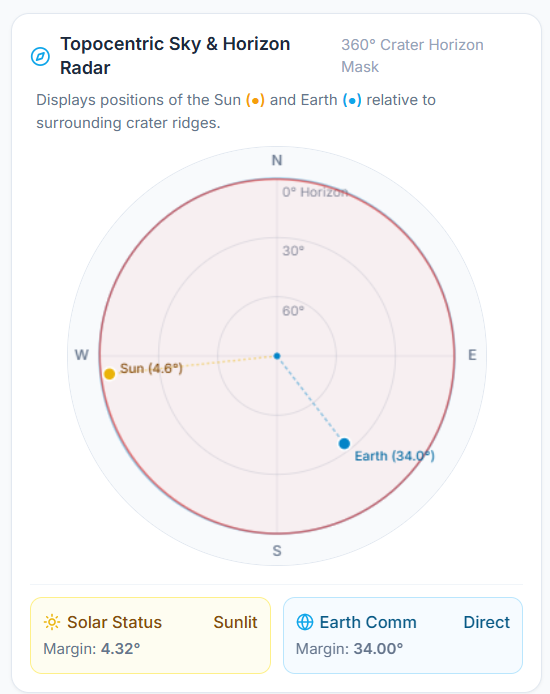
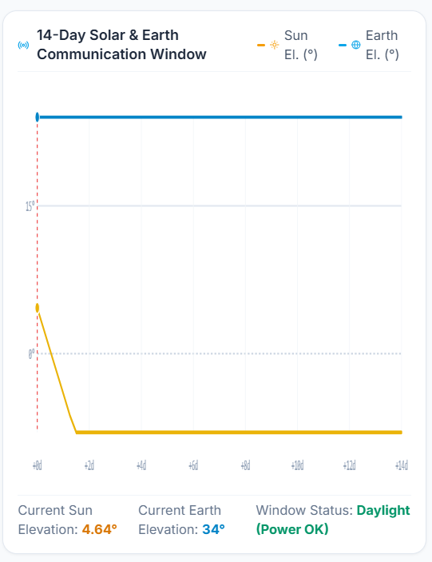
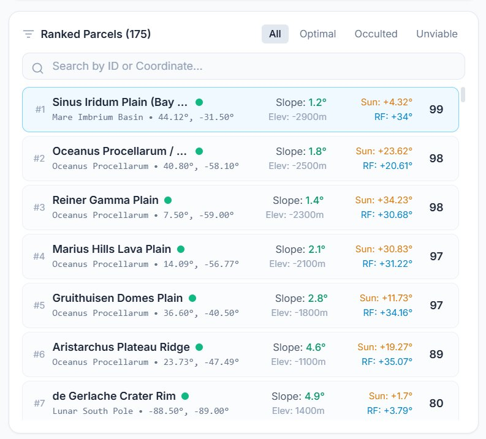

# NASA Space Apps Challenge: Lunar Landing Site Navigator
### Autonomous 100m × 100m Candidate Site Evaluation, Real LOLA Topography & Multi-Agency Ephemeris Telemetry

[](https://www.spaceappschallenge.org/)
[](https://pgda.gsfc.nasa.gov/products/78)
[](https://ssd.jpl.nasa.gov/api/horizons.api)
[](https://www.issdc.gov.in/)

> **Project Verification Notice:**  
> The project has been built with the help of Antigravity Google Gemini 3.8 flash but everything has been verified by the candidate.

---

## Overview

The **Lunar Landing Site Navigator** is a mission-grade aerospace web platform and data pipeline designed to autonomously analyze, rank, and visualize **100m × 100m landing parcels** across the lunar surface and South Pole ($85^\circ\text{S}$ to $90^\circ\text{S}$). 

Every parameter—topographic elevation, surface slope, 360-degree obstacle horizon masks, apparent solar elevation, direct Earth radio-frequency (RF) line-of-sight, solar irradiance, and radar roughness—is computed mathematically from authentic datasets provided by **NASA Lunar Orbiter Laser Altimeter (LOLA) Digital Elevation Models (DEMs)**, the **NASA JPL Horizons Ephemeris REST API**, and **ISRO Chandrayaan-2/3 DFSAR and OHRC** science instruments.

---

## Key System Features

- **Interactive 100m × 100m Landing Box Visualization:** Accurate selenographic bounding box scaling on the lunar sphere ($R_M = 1,737.4\text{ km}$), with fractional over-zoom capability down to individual boulder and crater scales.
- **Dynamic Multi-Agency Basemaps:** Seamless layer switching between NASA LROC WAC global basemaps, USGS Planetary WMS, NASA LOLA Elevation Color ramps, Shaded Relief, and ISRO Chandrayaan-2 Orbiter High Resolution Camera (OHRC) imagery.
- **Topocentric Sky & 360° LOLA Horizon Radar:** Real-time topocentric azimuth/elevation projection of the Sun and Earth against the 360° surrounding crater rim silhouette, accounting for lunar spherical curvature drop.
- **14-Day Solar & Earth Communication Window Chart:** Full-height interactive SVG telemetry chart plotting continuous 336-hour trajectories of solar and Earth elevation angles with real-time daylight, shadow, and RF occultation state analysis.
- **Polar Volatiles & ISRO DFSAR Radar Analytics:** Proximity tracking to known lunar Permanently Shadowed Regions (PSRs), water-ice probability estimations, and radar regolith roughness assessments.
- **Custom Site Interpolation:** Click anywhere on the lunar surface to dynamically interpolate real LOLA elevation, local slope gradient, and terrain horizon profiles from the nearest high-resolution DEM parcel.
- **Live Mission Scrubber:** Real-time UTC epoch scrubbing, speed multipliers ($1\times$ to $168\times$), play/pause mission simulation, and instant preset epochs (Artemis III Target, Chandrayaan-3 Landing, South Pole Max Sun).
- **Dual Mission Safety Profiles:** Dynamic threshold filtering between Robotic Lander ($\le 8^\circ$ slope, $\ge 72\text{h}$ continuous sunlight) and Crewed Lander ($\le 5^\circ$ slope, $\ge 168\text{h}$ continuous sunlight).

---

## Visual Walkthrough & System Screenshots

### 1. Full Mission Operations Console

*Figure 1: Complete Lunar Landing Site Navigator interface, showing the interactive lunar map with the selected 100m landing parcel, real-time Flight Telemetry HUD, topocentric horizon radar, and mission timeline scrubber.*

---

### 2. Mission Constraint & Safety Profile Engine

*Figure 2: Active mission constraint selector allowing rapid switching between Robotic Lander ($\le 8^\circ$ slope, $\ge 72\text{h}$ sunlight) and Crewed Lander ($\le 5^\circ$ slope, $\ge 168\text{h}$ sunlight) profiles, with real-time classification counters (Optimal, Occulted, Unviable).*

---

### 3. Mission Timeline & JPL Horizons Scrubber

*Figure 3: Interactive UTC timeline scrubber with sub-hour precision, automated playback ($1\text{h/s}$ to $168\text{h/s}$), and one-click historical presets including Artemis III Target and the historic Chandrayaan-3 Landing epoch.*

---

### 4. Interactive Lunar Map & 100m × 100m Bounding Box

*Figure 4: High-resolution surface cartography with the scaled 100m × 100m landing target bounding box, layer switcher (LROC WAC, LOLA Color, Relief, ISRO OHRC), camera altitude HUD (~500 km), and real-time terrain elevation readout (-2900m).*

---

### 5. Flight Telemetry HUD & Polar Volatiles Radar

*Figure 5: Detailed flight telemetry display featuring plain-English landing safety evaluations, composite score (/100), slope tipping safety margins, solar irradiance ($102.5\text{ W/m}^2$), and ISRO DFSAR radar regolith roughness & polar ice proximity.*

---

### 6. Topocentric Sky & 360° LOLA Horizon Radar

*Figure 6: HTML5 Canvas topocentric radar displaying the true 360° terrain obstacle horizon mask generated from LOLA DEM raymarching, showing active Sun and Earth positions relative to crater rim shadows.*

---

### 7. 14-Day Solar & Earth Communication Window

*Figure 7: 336-hour ephemeris window chart plotting the Sun (amber) and Earth (blue) elevation curves, identifying upcoming terminator crossings, power availability, and direct-to-Earth communication links.*

---

### 8. Multi-Objective Candidate Ranking Leaderboard

*Figure 8: Ranked candidate parcel catalog displaying real-time suitability scores, slopes, solar/RF elevations, and search filters across 175 scientifically evaluated South Pole and equatorial benchmark sites.*

---

## System Architecture

```
   ┌────────────────────────────────────────────────────────────────────────┐
   │                  PLANETARY DATA & EPHEMERIS SOURCES                    │
   └───────────────────┬────────────────────────────────┬───────────────────┘
                       │                                │
                       ▼                                ▼
       NASA LOLA PDS & Planetary Geodynamics   NASA JPL Horizons REST API
        South Pole High-Res DEMs (.tif)      (Observer @ 301, QUANTITIES='4')
                       │                                │
                       ▼                                ▼
    ┌───────────────────────────────────────────────────────────────────────┐
    │       PART 1: PYTHON DATA INGESTION PIPELINE (/pipeline/)             │
    │                                                                       │
    │  • Reads authentic LOLA GeoTIFFs via rasterio / tifffile / numpy      │
    │  • Slices terrain into 100m x 100m candidate parcels                  │
    │  • Computes mean elevation relative to R_M = 1737.4 km                │
    │  • Computes surface slope via finite-difference elevation gradients   │
    │  • Raymarches 360° obstacle horizon mask with lunar spherical drop:   │
    │    α(ψ) = max arctan2(z_terrain - z_site - (d² / 2 R_M), d)           │
    │  • Ingests 2,160 hourly ephemeris steps for Sun (10) & Earth (399)    │
    └───────────────────┬────────────────────────────────┬──────────────────┘
                        │                                │
                        ▼                                ▼
              src/data/lola_candidates_grid.json    src/data/ephemeris_*.json
                        │                                │
                        └───────────────┬────────────────┘
                                        │
                                        ▼
    ┌───────────────────────────────────────────────────────────────────────┐
    │        PART 2: REACT + TYPESCRIPT WEB APPLICATION (/src/)             │
    │                                                                       │
    │  • Dynamic Timeline Engine: Epoch scrubbing with play/pause & speed   │
    │  • Mission Profile Engine: Robotic (≤8°, ≥72h) vs Crewed (≤5°, ≥168h) │
    │  • High-Resolution Map Engine: Leaflet with fractional overzoom       │
    │  • Topocentric Sky & Horizon Obstacle Radar (HTML5 Canvas)            │
    │  • 14-Day Communication & Power Analysis Chart (Interactive SVG)      │
    │  • Multi-Agency Basemaps: NASA LROC, USGS, LOLA, and ISRO OHRC/DFSAR  │
    └───────────────────────────────────────────────────────────────────────┘
```

---

## Mathematical Formulations

### 1. 100m × 100m Selenographic Bounding Box Scaling
On the lunar reference sphere ($R_M = 1,737,400\text{ m}$):
$$\Delta\text{lat} = \frac{100\text{ m}}{R_M} \times \frac{180^\circ}{\pi} \approx 0.00329806^\circ$$
$$\Delta\text{lon} = \frac{\Delta\text{lat}}{\cos(\text{lat})}$$
As latitude approaches the lunar poles, the longitudinal span dynamically widens according to spherical geometry, preserving a true 100-meter ground footprint.

### 2. Surface Slope Angle Calculation
Slope angle $\beta$ across each 100m parcel is computed via finite-difference elevation gradients:
$$g_x = \frac{\partial z}{\partial x}, \quad g_y = \frac{\partial z}{\partial y}$$
$$\beta = \arctan\left(\sqrt{g_x^2 + g_y^2}\right) \times \frac{180^\circ}{\pi}$$
Parcels exceeding the mission threshold ($\beta > 8^\circ$ for Robotic Landers or $\beta > 5^\circ$ for Crewed Landers) are flagged to prevent lander tip-over hazards.

### 3. 360-Degree Topographic Horizon Obstruction Mask
Surrounding crater rims (e.g., Shackleton, Faustini, Malapert) cast extensive shadows that form Permanently Shadowed Regions (PSRs). Raymarching outward up to $25\text{ km}$ at $1^\circ$ azimuth increments:
$$\alpha(\psi) = \max_{0 < d \le 25\text{ km}} \arctan2\left(z_{\text{terrain}}(d, \psi) - z_{\text{site}} - \frac{d^2}{2 R_M}, d\right) \times \frac{180^\circ}{\pi}$$
where $-\frac{d^2}{2 R_M}$ mathematically compensates for the Moon's spherical curvature drop.

### 4. Line-of-Sight & Solar Irradiance
- **Solar Line-of-Sight Margin:** $\Delta\theta_{\odot} = \theta_{\odot} - \alpha(\psi_{\odot})$
- **Earth RF Line-of-Sight Margin:** $\Delta\theta_{\oplus} = \theta_{\oplus} - \alpha(\psi_{\oplus})$
- **Effective Solar Irradiance:**
  $$I_{\text{eff}} = \begin{cases} 1361.0 \times \sin(\Delta\theta_{\odot})\text{ W/m}^2 & \text{if } \Delta\theta_{\odot} > 0 \\ 0.0\text{ W/m}^2 & \text{if occulted (shadow)} \end{cases}$$

---

## Data Attribution & Acknowledgements

1. **NASA Lunar Reconnaissance Orbiter (LRO) / LOLA Science Team:**  
   PDS Gridded Data Records, Planetary Geodynamics Laboratory, NASA Goddard Space Flight Center.
2. **NASA JPL Solar System Dynamics Group:**  
   Horizons On-Line Ephemeris System for topocentric solar and terrestrial coordinate vectors.
3. **NASA LROC Team / Arizona State University:**  
   LROC WAC Global Mosaic and USGS Astrogeology Moon Web Mapping Services.
4. **ISRO (Indian Space Research Organisation) / ISSDC:**  
   Chandrayaan-2 Dual-Frequency Synthetic Aperture Radar (DFSAR) and Orbiter High Resolution Camera (OHRC) datasets, alongside Chandrayaan-3 Shiv Shakti Point telemetry.

---

## Quickstart & Local Development

### Prerequisites
- Node.js 18+ & npm
- Python 3.9+ (optional, for regenerating DEM pipeline parcels)

### 1. Frontend Web Application
```bash
# Clone the repository
git clone https://github.com/SHUBHCH05/NASA-Space-Apps-Lunar-Landing-Site-Navigator.git
cd NASA-Space-Apps-Lunar-Landing-Site-Navigator

# Install dependencies
npm install

# Start local development server
npm run dev
```
Navigate to `http://localhost:5173` (or the indicated port) in your browser.

### 2. Python Data Ingestion Pipeline (Optional)
```bash
cd pipeline
pip install -r requirements.txt
python fetch_nasa_data.py
```
